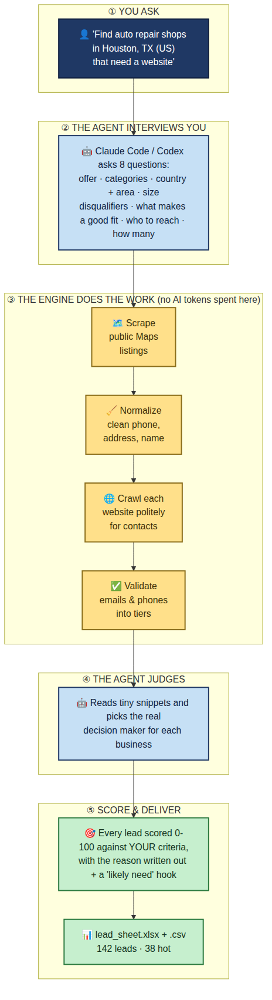
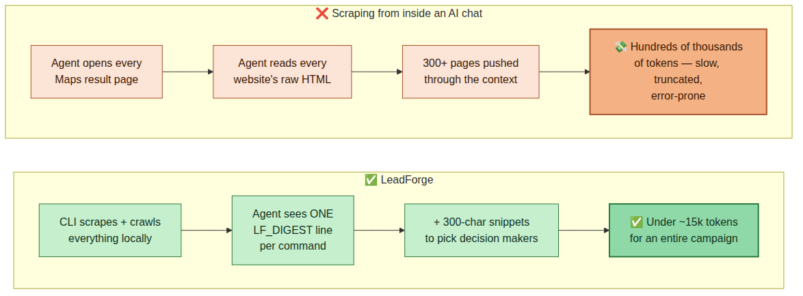
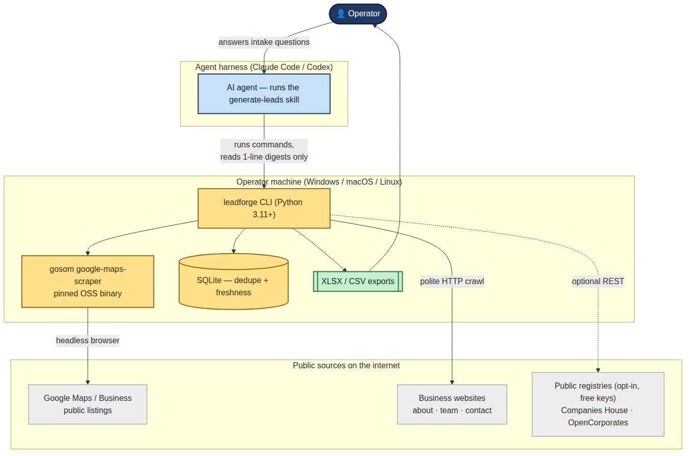

# LeadForge

**Internal B2B lead-generation engine.** Scrapes public business listings with open-source engines, deep-crawls
each business's website for contacts and the likely decision maker, scores every lead against your ICP, and
exports a clean, explained XLSX/CSV. Ships as one repo that installs into **Claude Code** and **OpenAI Codex**
as a plugin + Agent Skill.

> Internal tool, not a product. OSS-only: **no paid APIs, no API keys required** on the default path.

## How it works



## Why it exists

Doing this by hand is slow; doing it inside an AI chat burns enormous tokens on page dumps. LeadForge moves all
the heavy lifting into a Python CLI and leaves the agent three jobs: interview you about your ideal customer,
launch the pipeline, and judge who the decision maker is from tiny pre-extracted snippets. A full campaign costs
the agent **under ~15k tokens** — the pipeline itself processes hundreds of pages that never touch the model.



## Install


| Harness | Commands |
|---|---|
| **Claude Code** | `/plugin marketplace add AbdulrahmanAmer/leadforge` then `/plugin install leadforge@leadforge` |
| **Codex** | `codex plugin marketplace add AbdulrahmanAmer/leadforge` then install "LeadForge" from `/plugins` |
| **Any Agent-Skills harness** | `npx skills add AbdulrahmanAmer/leadforge` |
| **Plain CLI / bridge** | `git clone …` then `python install.py` |

Then, once, in the folder where you want your lead data to live:

```bash
leadforge doctor --fix --full  # installs deps, pinned scraper binary, AND the quality extras (GLiNER NER + crawl4ai browser + yt-dlp)
```

Requires **Python 3.11+**. No compiler needed — every default dependency is a pure-python wheel.
Windows, macOS and Linux are equal citizens.

### Upgrade an older or customized LeadForge copy

If you already have a LeadForge copy with local changes, do not overwrite it with a fresh checkout. Clone the
target release into a separate directory, compare it with your current workspace, and merge the upstream changes
selectively while preserving your configuration, lead data, exports, and intentional customizations. The complete
copy-paste instructions for Claude Code, Codex, and other coding agents are in the
[`customized-workspace upgrade prompt`](docs/UPGRADE-MERGE-PROMPT.md). The current stable target is `v0.6.0`.

The upgrade workflow includes a safety-point check, three-way comparison, schema/config/version review, focused
tests followed by the full suite, secret/generated-file checks, and an explicit final report. It does not use
destructive reset/checkout operations or force-pushes.

## Use it (the normal way)

Just ask your agent:

> "Find me B2B leads — auto repair shops in Houston that need a website."

The `generate-leads` skill triggers, interviews you (offer, categories, **country + specific area**, size band,
disqualifiers, what makes a good fit, decision-maker titles, volume), runs the pipeline, asks nothing else, and
hands back a sheet.

### Use it manually

```bash
leadforge intake --answers answers.yaml   # compile + validate your ICP -> icp.yaml
leadforge plan   --icp icp.yaml           # see the query plan before spending time
leadforge run    --icp icp.yaml           # discover -> enrich -> label -> score -> draft -> export (autopilot, v0.4)
leadforge watch                           # live progress bar for the run in this workspace (second terminal)
leadforge run    --icp icp.yaml --no-autopilot   # classic mode: pauses at stage=dm_pending instead
leadforge dm export --max 60              # (only needed with --no-autopilot, or to top up autopilot leftovers)
leadforge dm apply --in dm_labels.ndjson
leadforge run    --icp icp.yaml --resume  # score + export
leadforge status
leadforge config set registry.companies_house_key XXX  # read/write one leadforge.yaml value (set|get)
leadforge export --icp icp.yaml --format xlsx,csv      # re-export the latest run
leadforge suppress add someone@example.com   # opt-outs, honored everywhere (--kind domain|email|place_id)
leadforge render-check https://site.example  # diagnose one site: robots -> plain fetch -> browser -> contacts
leadforge dashboard --open                   # read-only status page: machine stages with measured pace + ETA, human stages
```

Everything lands under `./leadforge_data/` (gitignored): SQLite db, cache, logs, and `exports/<run>/` with the
XLSX, CSV and report.

## What a lead row contains

Score (0–100) and tier (A/B/C/D/DQ) · business name, category · **decision-maker name + title + confidence** ·
phone (spaced international format) · best **published** email + validity tier · an optional
**Email (Inferred)** column (opt-in; a likely address derived from the domain's own naming convention,
always labeled as a guess and never counted as a found email) · website · split address
(street/city/region/postal/country) · rating and review count · **"Likely Need (Hook)"** — a ready outreach
angle · **"Why This Score"** — the top factors in plain words · Maps link · source, verified-on date and a
**Stale?** flag · **Opening Hours** · a registry profile (**Company No, Incorporated, Company Status, SIC
Codes**) · and **Call Readiness** — whether the row is safe to dial right now. With
`scoring: {profile: account_fit}` the sheet appends 14 account-intel columns (Employees, Employee Range,
Revenue, Departments, Microsoft 365, CRM, ERP, Other Systems, Trigger, Trigger Strength, LinkedIn,
Contactability, Data Confidence, Status). **A cell is never empty** — a would-be blank says why it is blank
("none published", "not matched in registry", …). v0.3 appends **Fit**, **Contactability**, **Status**
(READY / CALL_ONLY / RESEARCH / DQ), **Next Action** (phone-first, or the outreach state once a lead is enrolled),
**Entity Type**, **Lawful Basis (Email)**, **Registry Name / Match**, **Chain**, **Site Status**, **Email
Confidence** and **All Hooks**. v0.4 appends **Draft Subject / Draft Body / Draft Grade / Draft Author**
("no draft" until autopilot or `draft apply` writes one) and a separate **Drafts** tab — one row per drafted
message, never sent.

The workbook also carries a **Summary** tab (counts, tier split, top hooks, compliance reminder for your region)
and an **About** tab that explains the columns — so your partner can read it without asking you.

## Enrichment coverage and verification

LeadForge keeps a field-level observation for enriched values. Each observation records its source URL, evidence,
confidence, verification state, provider, cost, jurisdiction, timestamps, freshness/recheck deadline, and (when
known) the person who owns the value. A business may have multiple people, and each person may have multiple phones
and emails. Public enrichment includes team/about pages, Schema.org `Person`, vCards, nearby `mailto:` links,
registry officers, press/speaker pages, and existing lawful Google Business Profile owner-reply evidence. Phones are
typed as `switchboard`, `main_line`, `direct`, `mobile`, or `unknown`; emails retain their stage: published personal,
published role, inferred pattern, or licensed-provider verification.

The default path remains OSS and keyless. Paid enrichment adapters are optional and disabled unless explicitly
configured. No LinkedIn scraping or SMTP mailbox probing is used. MX validation confirms that a domain can receive
mail; it does not claim that a particular mailbox exists.

For stricter outreach, require confirmation evidence in `leadforge.yaml`:

```yaml
outreach:
  require_email_confirmation: true
```

Strict mode permits only licensed-provider verification, actual delivery evidence, a reply, or explicit operator
confirmation. MX-only, inferred, risky, unknown, stale, and unconfirmed addresses are blocked before rendering or
sending.

Useful enrichment and benchmarking commands:

```bash
leadforge enrich --stage backfill       # project legacy contacts/people/evidence into observations
leadforge enrich --stage recheck        # report observations due for recheck
leadforge byol import --in contacts.csv # preview conservative matching (add --apply to write)
leadforge benchmark outcomes --in called.xlsx
leadforge benchmark outcomes --in called.xlsx --apply
leadforge benchmark dm-fields --in called.xlsx       # preview person-owned DM phone/email calibration
leadforge benchmark dm-fields --in called.xlsx --apply
```

The benchmark importer accepts CSV/TSV and calling workbooks. It understands WESCORE-style `Dialing List`, `List #2`,
`List #3`, `Call Log`, and callback tabs, maps human dispositions to canonical outcomes, preserves sheet provenance,
and uses stable business ID, domain, phone, or existing contact evidence for conservative matching. It is preview-only
unless `--apply` is supplied. See [`docs/10-enrichment-phase0-baseline.md`](docs/10-enrichment-phase0-baseline.md) for
the baseline, metrics, risks, and implementation order.

`benchmark dm-fields` is the operator-calibration path for workbooks containing `Decision Maker`, `DM Title`,
`DM Direct Phone / Best Route`, and DM email columns. It records the route as human-called evidence tied to the
person and workbook sheet; it does not replace public-source observations. See the ongoing accuracy loop in
[`docs/DM-PHONE-RESEARCH-ITERATIONS.md`](docs/DM-PHONE-RESEARCH-ITERATIONS.md).

## Under the hood

```
interview → ICP → geo-aware query plan → OSS Maps scraper → normalize (clean, sheet-ready fields)
   → polite website deep-crawl → emails/phones/socials/people candidates → validate (tiers, never booleans)
   → agent labels the decision maker from snippets → weighted ICP scoring with explanations → XLSX/CSV/SQLite
```



All diagrams as images: [`docs/diagrams/`](docs/diagrams/).
Architecture, data model, pipeline behavior and every decision are documented in [`docs/`](docs/):
[vision](docs/00-vision.md) · [research](docs/01-research.md) · [architecture](docs/02-architecture.md) ·
[data model](docs/03-data-model.md) · [pipeline](docs/04-pipeline-behavior.md) ·
[build plan](docs/05-icm-build-plan.md) · [token contract](docs/06-token-contract.md) ·
[compliance](docs/07-compliance.md) · [decisions](docs/08-decisions.md) ·
[customized-workspace upgrade prompt](docs/UPGRADE-MERGE-PROMPT.md).

## Ground rules baked into the code

- **robots.txt respected** on business sites; one request in flight per host with a delay; identifying user-agent.
- **Caps** from your ICP are hard stops; a **suppression list** is honored at crawl, score and export time.
- **No SMTP probing** (email validity is reported as tiers, never a false binary), **no LinkedIn**, **no
  login-gated scraping**, **no anti-bot evasion**, **no dialer, no SMS**. Public business data only.
- **Email sending is opt-in and audited (v0.3, ADR-011):** dry-run by default, `--live` only with `outreach.armed: true`
  and a named approver, approval bound to the message's content hash, suppression / eligibility / caps / warm-up / send
  window and current email verification/recheck state re-checked before rendering/sending, one-click unsubscribe,
  bounces and complaints written to the suppression list automatically, a per-mailbox circuit breaker. Strict mode
  additionally requires licensed-provider verification or delivery/reply/operator confirmation. No paid service is
  required or bundled (ADR-012): the transport is whatever mailbox you configure.
- **Country is required** on every campaign and areas must be specific — vague locations are how lead lists fill
  with garbage, so the tool refuses them and asks instead of guessing.
- **Autopilot never sends anything (v0.4, ADR-015):** `leadforge run` labels decision makers, scores, drafts and
  exports on its own by default, through the operator's own Claude Code in headless print mode — no API key, no
  paid dependency, disable with `agent.command: []` or `--no-autopilot`. It stops at a drafted, unsent sheet;
  outreach still requires `outreach approve` and `--live` exactly as before.

See [`docs/07-compliance.md`](docs/07-compliance.md) for the practical GDPR/PECR/CAN-SPAM posture. Not legal advice.

## Outreach and drafting (v0.3)

The sheet's **Next Action** column is phone-first: call rows with a validated phone and a named contact, email
is the second touch. `leadforge outreach plan` enrols eligible leads (entity type + lawful basis computed per
row, chains de-duplicated, suppressed and dead-site rows excluded); `leadforge draft export` hands the agent a
compact evidence packet per lead (≈160–270 tokens) and `draft apply` accepts only drafts whose every number,
address, URL and proper noun exists in that packet; `outreach approve` binds a human approval to the content
hash; `outreach send` is a dry run that writes `.eml` files until the owner arms the workspace and passes
`--i-am`. `outreach doctor` checks SPF, DKIM, DMARC, MX and mailbox warm-up and fails closed; `outreach sync`
turns bounces, complaints, unsubscribes and replies into suppression rows and state changes; `outreach outcome
add` records what happened on the phone so the next scoring pass learns from real outcomes. Full protocol:
`skills/generate-leads/references/outreach.md` and `drafting.md`.

**Company mode** (GainLev's own client pipeline): `target.mode: company` with SIC codes discovers companies
from Companies House by activity and location, resolves their websites without paid lookups, and scores them
with a company rubric (incorporation age, new-director trigger, hiring). Example ICP:
`config/icp.company.example.yaml`.

## Status

**v0.6.2 — DM-route accuracy iteration (2026-10-14).** LeadForge now stores field-level enrichment
observations with provenance, confidence, verification, ownership, freshness, jurisdiction, and cost; supports
multiple people and contacts, richer public structured-person/team-card extraction, conservative BYOL and
person-owned calling-workbook
benchmarks, source/provider/outreach attribution, and opt-in strict email confirmation based on licensed-provider,
delivery, reply, or operator evidence. The OSS/no-key path remains the default; SMTP mailbox probing and LinkedIn
scraping remain excluded.

**v0.4.0 — autopilot (2026-09-03).** `leadforge run` now finishes itself: decision-maker labeling, scoring,
drafting and export happen in one call by default (`pipeline.autopilot`), driven by the operator's own
headless Claude Code where available and deterministic fallbacks (`heuristic_labels`, `template_draft`)
everywhere else — see ADR-015 in [`docs/08-decisions.md`](docs/08-decisions.md).
`--no-autopilot` restores the v0.3 pause-for-the-agent behavior exactly. The sheet gains Draft
Subject/Body/Grade/Author columns and a Drafts tab; nothing is ever sent by this — outreach is still a
separate, explicitly-armed step.

**v0.3.0 — truth, coverage, outreach (2026-09-03).** Measured on the live 816-row campaign: the sheet now separates
**Fit** from **Contactability** and carries **Status / Next Action / Entity Type / Lawful Basis / Registry Match /
Chain / Site Status / Email Confidence / All Hooks**; hooks fire only on observed evidence (no more "no online
booking" on sites that were never read); a freemail address never outranks the business's own mailbox; registry
matches require a name-similarity gate and an active company; Google Business Profile facts (booking links,
appointment attributes, owner reply signatures) are kept; the DVSA MOT-station register is a discovery provider
merged into Maps rows by phone; tiled Maps queries subdivide when they saturate and `--resume` finishes a run's
pending queries; the geocoder resolves bare city names to the city. Release gate: `python scripts/v03_gate.py`.

**v0.1.4 — shipped and live-validated** with a 709-lead UK auto-repair campaign (2026-08-31). Every ICM unit
is implemented and tested. Since v0.1.1: a **registry stage** that covers site-less businesses and adds a
Companies House profile (company number, incorporation, status, SIC codes); a **Call Readiness** column;
`LF_PROGRESS` heartbeat lines + a live progress bar and `leadforge watch`; and a **browser fallback** for sites
that bot-wall the plain HTTP client (robots.txt is always honored — disallowed sites never escalate).
Deferred to v0.2: a grid-tiling live run and real Facebook/Instagram presence probes. gosom serve mode is
closed by design (resume + a stall watchdog cover it). Previously deferred, shipped in 0.1.4:
`claude plugin validate` in CI, TSV dm reconciliation, grid bbox flag-format verification (see `icm/STATE.md`).

```bash
pip install -e .[dev] && pytest -q && ruff check src tests   # suite must be fully green (no xfails)
```

Optional extras: `.[browser]` (JS-rendered + bot-walled sites), `.[ner]` (local zero-shot name/title
extraction) and `.[social]` (yt-dlp presence probe) are installed automatically by
`leadforge doctor --fix --full`; `.[addressing]` (better US address splitting) is available but manual —
`pip install -e .[addressing]`.

## License

MIT — see [LICENSE](LICENSE). Bundled/pinned third-party engines keep their own licenses; the Google Maps
scraper engine ([gosom/google-maps-scraper](https://github.com/gosom/google-maps-scraper), MIT) is downloaded at
setup time, not vendored.
