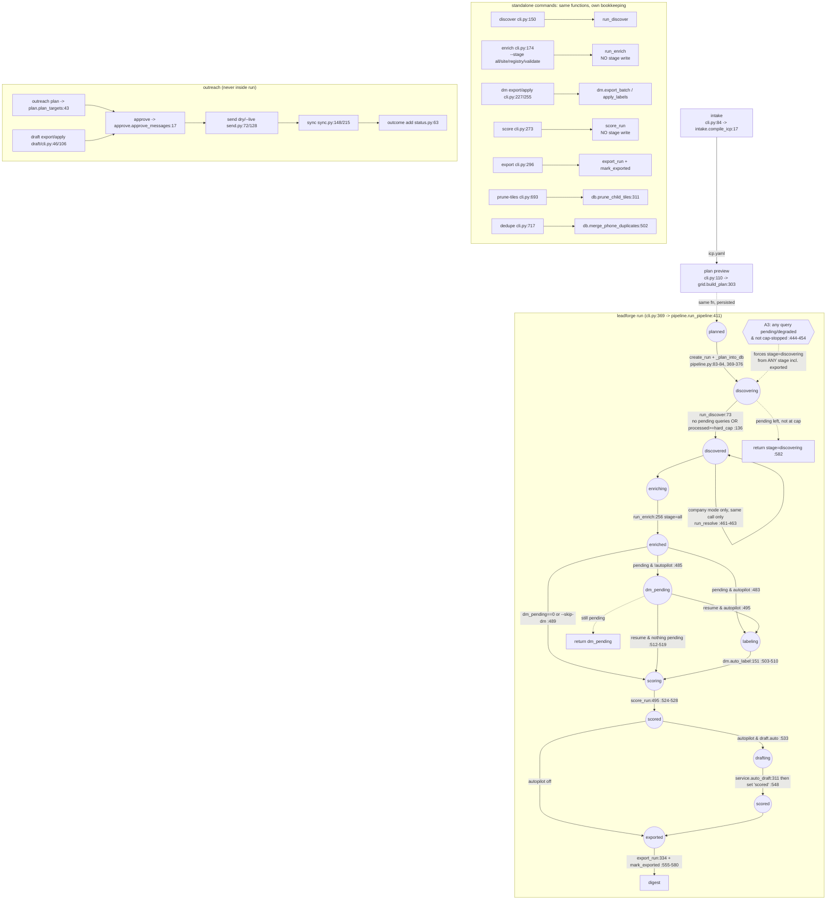

# LeadForge pipeline map: logic, wiring and cleanup plan

Snapshot of `src/leadforge` (~15.1k lines) as of 2026-09-25. Every `file:line` is relative to
`src/leadforge/`. Tests are in `tests/`. **UNVERIFIED** marks a claim taken from reading the code
that has not been reproduced by running it.

Premise, from the owner: old databases and workspaces will not be supported. Compatibility code is
therefore listed as removable, not as a constraint.

---

## 1. Stage diagram

`run.stage` values (`pipeline.STAGES`, pipeline.py:41-44):
`planned, discovering, discovered, enriching, enriched, dm_pending, labeling, scoring, scored,
drafting, exported`.

The values do not mean the same thing. Some mark a stage being entered (`enriching`, `labeling`,
`drafting`). Others mark a stage just finished (`enriched`, `scored`). `scoring` actually means
"labeling finished" (pipeline.py:505). `drafting` jumps back to `scored` when it finishes
(pipeline.py:548).



Inside `enrich` (runner.py:256-290). There are two separate code paths.

```mermaid
flowchart LR
  subgraph overlapped["stage=all & enrich.overlap_stages (default) runner.py:271-276"]
    CR[crawl driver thread<br/>ThreadPool(politeness.workers)<br/>_process_one:91] -->|closure| Q[(write queue)]
    CR -->|per crawled biz, off-thread| RL[_lookup_registry_for:658]
    RB[registry backlog thread<br/>biz NOT in crawl queue] -->|closure| Q
    Q --> W[main thread _drain_queue:294<br/>_persist:571 incl. inline validate_email]
    W -.->|queue empty| V[_validate_stage:818 every 20 ms]
  end
  overlapped --> G[_gbp_stage:763] --> I[_infer_stage:424] --> V2[_validate_stage final]
  subgraph serial["single --stage X runner.py:277-287"]
    S1[_crawl_stage:538<br/>registry inline via _registry_cross_check:709] --> S2[_registry_stage:463] --> S3[_gbp_stage] --> S4[_infer_stage] --> S5[_validate_stage]
  end
```

---

## 2. Stage by stage

| Stage | Entry | Reads | Writes | External calls | Concurrency | Resume |
|---|---|---|---|---|---|---|
| intake | cli.py:84 → intake.compile_icp:17 | answers.yaml | icp.yaml; company mode imports company.py and registers a profile (intake.py:124-141) | none | none | n/a |
| plan (create) | pipeline._plan_into_db:369 → grid.build_plan:303 | icp (categories, geography, caps.max_tiles), `discovery.grid_mode/grid_cell_km/area_bbox/providers/est_*`, geocode cache | `runs` row (db.create_run:231), `queries(run_id,query_text,tile_json)` (db.add_queries:284). Register queries run first (grid.py:348-351) | Nominatim geocode, 1 req/s, cached (grid.py:109-208) | none | `ensure_run:356` reuses the latest run for this icp_hash |
| discover | pipeline.run_discover:73; per result `_apply_query_result:167` | `queries` pending; `businesses.cid` (known_cids :116); `suppression` (db.is_suppressed:647); `caps.max_leads`; `discovery.parallel_queries/subdivide_at/max_subdivisions/subdivide_min_new` | `businesses` via upsert_business:400 (insert, or richest-field merge by dedupe_key → place_id → phone :406-410); `enrich_json.gbp` (normalize.py:357) and provider `enrich_for` (pipeline.py:182-186; e.g. dvsa, CH `registry_profile`); `queries.status/result_count/new_count` (db.finish_query:296); child tiles (:217-232) | gosom subprocess, Playwright maps_list, dvsa CSV HTTP, Companies House HTTP, fallback_rest HTTP | serial :237, or N borrowed provider chains :262 with all DB writes on the main thread | pending queries continue. Degraded queries are reset to pending on the next call (:88). The per-run cap is seeded from `first_run_id` (:99-101) |
| resolve_domain (company mode) | pipeline.py:461-463 → resolve_domain.run_resolve:114 | `businesses` where `source='companies_house' AND domain IS NULL AND no domain_resolution` (:117-122) | `businesses.website/domain` (:98), evidence `domain_resolved`, `enrich_json.domain_resolution` | HTTP GET on guessed domains via SiteCrawler | serial | **Only runs if discover ran in the same invocation.** A resume from `discovered` skips it. Not in STAGES |
| enrich: crawl | runner._process_one:91 (static, then browser rescue :102-137, then browser escalation :159-178) | businesses_for_enrich:461 (domain set, no crawled_at/attempted_at, not suppressed); `crawl.*`, `enrich.rendered_pages_per_site` | via `_persist:571`: `contacts` email/phone/social (:600-611), `people` origin=heuristic (:613), `evidence` email_found/dm_candidate/social_presence, `enrich_json` crawled_at or attempted_at+error, signals, socials, pages, needs_browser, registry_checked, profile, social_presence (:636-655) | httpx site crawl with robots; crawl4ai browser; GLiNER NER worker process (runner.py:193-253); agent-reach/yt-dlp for social | ThreadPool(politeness.workers) plus HostThrottle; writes on one thread | idempotent: rows with crawled_at or attempted_at are skipped. needs_browser rows are retried when a browser is present (db.py:465) |
| enrich: validate (inline) | runner.py:591 `validate_email` inside `_persist` | email + label | `contacts.tier/meta_json` | DNS MX, lru-cached per domain (validate.py:59-61) | runs on the **writer thread** | n/a |
| enrich: registry | overlapped: `_lookup_registry_for:658` + `_persist_registry_result:690`. Serial: `_registry_stage:463`, `_registry_cross_check:709` | `enrich_json.registry_checked IS NULL AND no people with labeled_by='registry'` (:336-341, :471-475); `registry.*` | `people` origin/labeled_by=registry (registry.py:168-171); evidence registry_officer; `enrich_json.registry_checked/registry_profile` (:702-705); **auto-picks the DM** (`_auto_pick_registry_dm:792` → `people.is_dm=1, dm_confidence=0.9`) | Companies House or OpenCorporates HTTP; CH token bucket, disabled on 429 (registry.py:118-121) | a registry backlog thread plus a lookup inside the crawl-driver thread | skipped once registry_checked is set |
| enrich: gbp | inline `_apply_gbp:722` for crawled rows; `_gbp_stage:763` for the rest | `enrich_json.gbp` written at discover | `people` origin=gbp; `signals.booking_hint` | none | serial | the query matches every business that has no gbp person. `gbp` is never null (normalize.py:283-308), so this is nearly every row on every call |
| enrich: infer | `_infer_stage:424` (opt-in `validation.infer_emails`) | `people.is_dm=1`; known emails | `contacts` tier=inferred with **no affinity** (:450-453); evidence email_inferred | DNS MX | serial | runs **before labeling**, so only registry-auto-picked DMs are covered (docstring :428-430) |
| enrich: validate (sweep) | `_validate_stage:818` | `contacts` where tier in ('unknown','') | `contacts.tier/verified_at/meta_json` | DNS (pool of `enrich.dns_workers`) | pool; writes on the caller thread | see R7: a same-process retry cannot change the result |
| DM gate / label | pipeline.py:479-521 → dm.auto_label:151 (agent_runner NDJSON, then heuristic_labels:130); manual path is dm.export_batch:64 / apply_labels:111 | db.dm_pending:593 (businesses with people and no `is_dm!=0`); `icp.decision_maker.titles_priority`; `agent.batch/max_batches` | `people.is_dm (1/-1), dm_confidence, title, labeled_by (agent/heuristic_auto), labeled_at` (dm._set_dm:214); run stats dm_labeled/dm_unlabeled/dm_runner (pipeline.py:505) | headless `claude` subprocess (agent_runner.run_agent:139) | batches in sequence, bounded by `agent.max_concurrent` | idempotent: only businesses still pending. With autopilot off, parks at `dm_pending` |
| score | score.score_run:495 → PROFILES: default score_run_default:507, account_fit :700, company company.py:278 | **all** businesses (db.all_businesses, score.py:510; not only this run's), people, contacts, enrich_json, chain_map:488, rubric YAML, cfg.validation.freemail_policy, outreach.require_corporate | `scores(business_id,run_id,total,tier,factors_json incl. meta contactability/status,need_hooks_json)` (db.save_score:613) | none | serial | re-scores everything each time (upsert) |
| draft (autopilot) | service.auto_draft:311 | scores_for_run (tiers in `draft.auto_tiers`), contacts, people, sending_identities, evidence | `outreach_targets` (ensure_targets:80: state=enrolled, **no identity/contact/eligibility**); `messages` drafted/rejected with author (apply_drafts:198); `outreach_targets.state='drafted'` via raw UPDATE (:239) | headless `claude`; deterministic template fallback (draft/template.py:84) | batches of `agent.batch`, then gated retries (:387-402) | skips targets that already have a `drafted` message. **Abstained and rejected-only targets are re-sent to the agent on every resume** (:327-334) |
| export | export.export_run:334 → _row_for:151; digest summarize_for_digest:639 | scores_for_run:626 (suppression filtered), people, contacts, evidence, enrich_json, chain_map, messages+targets, suppression, outreach_state_for | xlsx (Leads/Drafts/Summary/About), csv, report.json under `exports/<run>/`; `runs.stage=exported` (db.mark_exported:277) | opens the xlsx if `export.auto_open` | serial | re-runnable |
| outreach plan → sync | plan_targets:43, approve_messages:17, send.py:72 (dry) / :128 (live), sync_spool:148 / sync_inbox:215 | see §3 | outreach_targets, messages, events, suppression, mailboxes | SMTP (outreach/transport/smtp.py), IMAP, .eml files, DNS (outreach doctor) | serial | states.transition:67 guards moves (bypassed at service.py:239) |

---

## 3. Data model: writers and readers

Stage keys: **D** discover · **RD** resolve_domain · **C** crawl/_persist · **V** validate ·
**RG** registry · **G** gbp · **I** infer · **L** label · **S** score · **DR** draft ·
**X** export · **O** outreach · **MIG** db.migrate · **REP** repair CLI (dedupe, prune-tiles).
⚠ marks a column one stage writes and a later stage rewrites or corrects.

| Table.column(s) | Written by | Read by |
|---|---|---|
| runs.stage, stats_json | D (pipeline.py:85,137), run_pipeline (:470-577), X (cli.py:318); `set_run_meta` for --detach (db.py:266) | run_pipeline, status (cli.py:475), dashboard |
| runs.icp_hash ⚠ | create_run; **re-stamped** by `_latest_run` (pipeline.py:60-70) | resume lookup |
| queries.status ⚠ | D (finish_query); D resets degraded→pending (:88); **REP prune-tiles → skipped** (db.py:355) | D, A3 check (pipeline.py:444) |
| queries.new_count | D (:234) | novelty gate (:213); REP prune-tiles |
| businesses core (name, name_norm, phone_e164, address_*, lat/lng, rating, place_id, cid, maps_url, category, categories_json) ⚠ | D (insert/merge db.py:400-458); **REP dedupe re-merges** (db.py:502-543) | all later stages |
| businesses.address_country ⚠ | D, stored as the provider's raw string (normalize.py:374; e.g. "United Kingdom", dvsa.py:228) | **re-mapped** by C (`_region_for_business` runner.py:77), RG (`_jurisdiction` runner.py:84), S (`_COUNTRY_ALIASES` score.py:273-290) |
| businesses.website, domain ⚠ | D; **RD fills them in** for CH rows (resolve_domain.py:98) | C, V, RG, S, X, DR, O |
| enrich_json.gbp ⚠ | D (normalize.py:357, always a dict; the merge uses `setdefault`, so an empty register-row gbp **shadows** the real Maps one, db.py:447-449) | G, draft packet |
| enrich_json.registry_profile, registry_checked ⚠ | D (CH enrich_for, companies_house.py:158-179); RG (:494-497, :702-705); **C overwrites registry_checked=bool(registries)** (runner.py:650) | RG filter, S (compliance.entity_type), X, draft packet, company score |
| enrich_json.crawled_at, attempted_at, error, pages, signals, socials, profile, needs_browser | C (runner.py:636-655); signals also from G (:777) | businesses_for_enrich, S (`_has_signal` score.py:223), X (`_site_status` export.py:104), O (site_is_dead) |
| contacts (email) value/label | C (:600) and I (:450) | V, S, X, DR, O |
| contacts.tier ⚠ | C (inline validate, :591-601); **V rewrites unknown rows** (:834); I sets 'inferred' | S, X, DR, O |
| contacts.affinity ⚠ | C only (:592); **I writes none**; legacy rows are empty | **backfilled on every read** by `fill_email_affinity` (score.py:467) in S (:327), X (:162, :422), DR (service.py:67), O (plan.py:77, send.py:51/61), plus `compliance._infer_affinity` (:112, :125) |
| contacts (phone/social) | C (:607-611) | S (`_any_mobile`), X (Phone fallback, Call Readiness) |
| people rows | C (heuristic :613), RG, G (:742/:755) | L, S, X, DR, infer |
| people.is_dm, dm_confidence ⚠ | **RG auto-pick (runner.py:811-814)**, then L agent (dm.py:104), then L heuristic (dm.py:144); reject writes -1 (:97) | dm_pending, S, X, DR, I |
| people.labeled_by ⚠ | insert = source (heuristic/registry/gbp); **L overwrites it with the decider** (agent/heuristic_auto, dm.py:218-224). RG auto-pick keeps 'registry' | S `registry=any(labeled_by=='registry')` (score.py:216), compliance.entity_type (:51), RG filter (runner.py:340, :474), compliance.name_allowed fallback (:178) |
| people.origin | insert (db.py:585, defaults to labeled_by); MIG v2 backfill (db.py:203) | dm.batch_lines (:55), G dedupe (:737), name_allowed |
| people.name ⚠ | insert; **MIG v5 rewrites "Last, First"** (db.py:165-183) | L, DR, I |
| evidence | C, RG, G, I, RD | X (Verified On = newest observed_at, export.py:182-184), draft packet |
| scores.* (incl. meta contactability/status) | S | X, DR (`ensure_targets`), O plan (tier), top_hooks. X **recomputes** eligibility, entity, next action and best email instead of reading them (export.py:268-305) |
| outreach_targets | DR ensure_targets (service.py:92), O plan (plan.py:110); state via transition, plus a raw UPDATE at service.py:239 | DR, X (Next Action, Drafts), O |
| messages | DR (service.py:233/242); O approve/send (approve.py:47, send.py:150/208/221/231) | X (Draft cols, Drafts sheet, summarize_for_digest), O |
| events | O sync (sync.py:125) | O send circuit breaker (send.py:113-118, reads `classification`, which sync never sets for bounces, sync.py:111-114) |
| suppression | `suppress` CLI (db.py:638), O sync/outcome | D (:187), businesses_for_enrich, scores_for_run, X, O |
| outcomes, sending_identities, mailboxes | O only | O, DR (identity_for, service.py:34) |

---

## 4. Repair steps: why each exists and the upstream fix

| # | Repair step | What it repairs | Upstream root cause | Upstream fix that removes it |
|---|---|---|---|---|
| R1 | **Affinity backfill**: `fill_email_affinity` / `fallback_email_affinity` (score.py:450-484) and `compliance._infer_affinity` (compliance.py:125-135), both called on every read in 7 places | contacts with `affinity=''` | Pre-v0.3 rows, and `_infer_stage` still inserting inferred emails without affinity (runner.py:450-453) | Write affinity on every email insert (I included). With old DBs dropped, delete both fallbacks and read the column |
| R2 | **Registry DM auto-pick inside enrich** (`_auto_pick_registry_dm` runner.py:792-815) plus `heuristic_labels` (dm.py:130-148) plus agent labeling | picks a DM, but in three places and at two stages | The labeling decision is made inside enrichment. `labeled_by` mixes up "where the person came from" and "who decided" (db.py:63-64) | One `resolve_dm()` in the label stage, with rules in order: single active registry director → agent → title heuristic. It writes a separate `dm_decided_by`, and `origin` stays the source |
| R3 | **`people.origin` column + v2 backfill** (db.py:137, :203) | labeling overwriting the source | Same as R2: labeled_by is overwritten (dm.py:218-224) | Split source from decider. Also fix readers that still test `labeled_by=='registry'`: score.py:216, compliance.py:51, runner.py:340/:474. After an agent labels a registry officer, those readers lose the registry corroboration (**bug, read from code, UNVERIFIED by run**) |
| R4 | **v5 migration `_normalize_people_names`** (db.py:165-183) | "Last, First" officer names | Old registry.py. Already fixed at entry (`natural_name`, registry.py:169) | Delete it (old DBs unsupported) |
| R5 | **Country re-mapping** in `_jurisdiction` / `_region_for_business` (runner.py:77-88) and `_COUNTRY_ALIASES` (score.py:273-290) | "United Kingdom"/"England" vs "GB" | to_business stores the raw provider string (normalize.py:374). "GB" is not a key of COUNTRY_TO_REGION (normalize.py:45-51) | Store ISO-2 in to_business, then delete all three re-maps |
| R6 | **`_gbp_stage` + inline `_apply_gbp`** (runner.py:722-778) | GBP people and booking signal for businesses the crawl never reached | GBP facts are known at discover (normalize.py:357) but are only turned into people/signals during enrich | Write GBP people and the booking signal in `_apply_query_result` (pipeline.py:167). Also fix the empty-gbp `setdefault` shadowing (db.py:447-449; attach gbp only when the provider has it) |
| R7 | **`_validate_stage` sweep plus the idle-loop re-validate** (runner.py:414, :818-838) | 'unknown' tiers (DNS timeouts) | Validation already happens inline in `_persist` (runner.py:591). `_mx_cached` is an `lru_cache` that **caches the `None` timeout result** (validate.py:59-61), so a same-process retry returns 'unknown' again. The idle loop re-selects, re-updates and commits those rows every 20 ms for the whole crawl (**read from code; not measured**) | Validate once, off the writer thread, as part of the crawl result. Don't cache `None`; retry timeouts once with backoff inside that call. Delete the idle-loop call and the sweep |
| R8 | **Registry split in three**: backlog thread, lookup in the crawl driver, and serial `_registry_stage`/`_registry_cross_check` (runner.py:336-367, :394, :463-504, :709-719) | "site-less businesses never got a registry lookup" (:464-466) | The registry lookup was attached to the crawl, but it depends only on name/postcode/country, which are known at discover. The paths disagree on `registry_checked` for uncovered jurisdictions (:713-717 vs :363) | Run one registry pass over every business, independent of the crawl (its own worker pool, rate-limited). `_persist` stops touching registry_checked (:650) |
| R9 | **`_infer_stage` re-run advice** ("re-run `enrich --stage infer` after `dm apply`", runner.py:428-430) | inferred emails missing for agent-labeled DMs | Infer runs inside enrich (runner.py:274/:284), which is **before** labeling (pipeline.py:501) | Run infer after label (as part of the label stage) |
| R10 | **A3 discovery re-entry** (pipeline.py:438-454) | businesses arriving after the run passed `discovered` | `discovered` is declared while queries are unfinished: degraded ones are not 'pending' (:135-137), and `--limit` / the cap stop early (:136). Degraded queries are only retried by resetting them at the next call (:88) | Retry degraded queries inside the discover loop with an attempt counter (final status `failed`). Declare `discovered` only when no query is pending/degraded, or the cap is reached (a cap stop is terminal). Then later stages never need to jump back |
| R11 | **Novelty gate + `prune-tiles`** (pipeline.py:210-218; db.prune_child_tiles:311-357; cli.py:692-713) | wasteful saturated child tiles | Subdivision had no yield check before v0.4.1. The gate now exists at creation time; prune-tiles only fixes runs recorded before `new_count` existed | Keep the gate. **Delete prune-tiles** (it uses a second threshold, `--min-new 3`, alongside `discovery.subdivide_min_new`) |
| R12 | **`dedupe` / merge_phone_duplicates** (db.py:502-543; cli.py:716-727) | register row sitting next to its Maps twin | Pre-v0.3.1 one-way phone merge. Now two-way (`_phone_match` db.py:378-397). The remaining root cause is that upsert never matches on `cid` (db.py:406-410) and dedupe keys differ by provider (normalize.py:341-351) | Also match on `cid`, and keep the two-way phone rule. Delete the dedupe command |
| R13 | **Legacy ICP hash re-stamp** (pipeline.py:60-70; models.py:199-203) | runs created before the 2026-09-03 hash change | the hash definition changed | Delete it |
| R14 | **Schema migrations v1→v5** (db.py:134-149, :185-227) | old DB shapes | history | Keep `_DDL` plus a version check that refuses older DBs |
| R15 | **Export recomputes** entity, eligibility, next action, best email and site status (export.py:268-305) and **Call Readiness** (:232-239) | "state can change between scoring and export" (:269-270) | Score computes the same things and throws away everything except `status`/contactability (score.py:314-396). Three readiness columns use different phone rules: Call Readiness uses e164 **or any site phone** (export.py:234), Next Action and Status use `phone_is_validated` (export.py:279, score.py:353) | Score persists the best contact id, entity, eligibility and next action. Export reads them and re-checks only live inputs (suppression, outreach_state). Drop Call Readiness, or define it from the same rule |
| R16 | **Draft gate retry + `infer_used_fact` + template fallback** (service.py:178-195, :384-405) | model drafts rejected for USED_FACT/PROPER_NOUN | LLM output. The prompt asks for a verbatim quote (service.py:261-264) | Legitimate, keep it. Record the final abstain/reject per target so a resume doesn't re-ask (service.py:327-334 only skips `drafted`) |
| R17 | **Send-time re-checks**: suppression, eligibility, mailbox caps, hash (send.py:145-204) | state changing after approval | Mostly legitimate. The hash re-check is effectively unreachable because nothing edits body_text in place. `_recompute_eligibility` defaults to region `us` when a target was created by `ensure_targets` (send.py:58-59) | Keep suppression/eligibility/caps. Create targets through one enrol function (see D7) so eligibility_json is always present |
| R18 | **`registry_checked` pre-set by CH provider** (companies_house.py:158-179) | stops re-looking-up companies discovered from CH | Correct intent, but it also skips the officer lookup, so company-mode rows may never get directors and `_f_new_director` reads "no data" (company.py:147-165) (**UNVERIFIED by run**) | Registry pass keyed on "officers fetched" rather than "profile known"; fetch officers by company number |
| R19 | **`_persist` "empty_crawl" guard** (runner.py:637-643) and `_has_signal` pages>0 check (score.py:223-230) | "phantom" crawls stamped crawled_at with zero pages | crawler returning ok with no pages (historical) | Keep one guard at the source (crawler/_persist). Delete the reader-side pages>0 checks once old data is gone |

---

## 5. Duplicated paths

| # | Same work, two (or more) paths | Where | Divergence today | Fix |
|---|---|---|---|---|
| D1 | `leadforge enrich/score/export` vs the same stages inside `run` | cli.py:174-210, 273-291, 296-326 vs pipeline.py:469-580 | Standalone picks `db.latest_run(conn)` for **any** ICP (cli.py:192, :281, :305); run uses the icp_hash (pipeline.py:63). `enrich` and `score` write no stage, while `export` marks the run exported. `score` doesn't set `scored`, so a later `run --resume` re-scores | Make standalone commands `run --only <stage>`: one run resolver, one bookkeeping path |
| D2 | Overlapped vs serial enrichment | runner.py:271-276 vs :277-287 | Two registry implementations (R8). test_overlapped_stages_match_serial_db_state (tests/test_enrich_speed.py:220) exists only to keep them equal | One path; `--stage` selects which steps run inside it |
| D3 | Three extract loops in `_process_one` | runner.py:105-136 (browser rescue), :141-157 (static), :159-178 (escalation) | The escalation path skips phones, socials, signals and profile. The rescue path does everything | `_extract_pages(pages) -> out` used by all three |
| D4 | "Best email" selection, 7 copies | score.py:334, compliance.py:108 (unfiltered `ranked[0]`), export.py:167-169 (drops invalid/inferred), export.py:423, service.best_contact:49 (valid/role and affinity), plan.py:79 (unfiltered), send.py:48 (tier only) | The address checked for eligibility, the one drafted for, the one shown and the one sent to can differ | One `best_mailable(contacts, policy)`; persist the result at score time (R15) |
| D5 | Contactability/status (score) vs Next Action/eligibility/Call Readiness (export) | score.py:314-396 vs export.py:232-305 | Different phone rules (R15) | Compute once in score |
| D6 | Affinity fallback, twice | score.fallback_email_affinity:450 and compliance._infer_affinity:125 (same logic) | none today | Delete both (R1) |
| D7 | Target enrolment | plan.plan_targets:43 (suppression, eligibility, chain and entity gates; stores identity/contact/eligibility) vs service.ensure_targets:80 (no gates, only `INSERT OR IGNORE`) | Autopilot targets have no identity_id, so send skips them (send.py:160-165). `plan` counts them as already_enrolled (plan.py:64-69) | One `enrol_target()` used by both |
| D8 | Draft ingestion guards | auto_draft skips drafted targets (service.py:327-334); CLI `draft apply` doesn't (draft/cli.py:106-133) | CLI re-apply inserts a second `drafted` message per target, and approve would approve both (outreach agent report; **UNVERIFIED by run**) | Move the guard into apply_drafts |
| D9 | Draft counts | summarize_for_digest:639-663 (all campaigns), _drafted_counts:599 (campaign-scoped), run stats (pipeline.py:566-576 merges them) | The digest and report.json can disagree | One count, campaign-scoped |
| D10 | Discover serial vs parallel loops | pipeline.py:237 vs :262 (both use `_apply_query_result`) | none (shared apply) | Keep only the parallel loop; parallel_queries=1 is the serial case |
| D11 | Registry HTTP clients | providers/registry.py (lookup_with_profile :100-180) vs providers/companies_house.py:66-129 | They share the bucket, but auth, 429 handling and the profile shape are duplicated (registry.py:134-137 vs companies_house.py:166-175). Double `_CH_BUCKET.wait()` at registry.py:153-154 | One CH client module |
| D12 | Environment/UI setup | `ensure_ready` + `_progress_ui` called in both run_discover (:75-76) and run_pipeline (:427-428) | cheap (stamp), but redundant | Call once from run_pipeline; discover takes it as given |
| D13 | CLI helpers | `_cfg`/`_say` in cli.py:28/56, draft/cli.py:30/39, outreach/cli.py:60/69 | none | Shared module |
| D14 | Mailbox health metrics | send.py:103-118 and status.py:38-41 | Both read `events.classification='bounce_hard'`, which sync never writes (sync.py:111-114): **the circuit breaker can't fire** | One function, reading `events.kind` |

---

## 6. Proposed target pipeline

Rule: `run.stage` = **last completed stage** (one meaning). Each stage is a function
`(conn, cfg, icp, run_id) -> counts` registered in one ordered table, used by both `run` and
the standalone commands.

| # | Target stage (run.stage after it) | Contents |
|---|---|---|
| 1 | `planned` | create_run + build_plan (company plan included) |
| 2 | `discovered` | fetch/normalize/upsert. ISO country. GBP people and booking signal. In-loop degraded retry. Novelty-gated subdivision. Declared only when no query is pending/degraded, or the cap is reached |
| 3 | `enriched` | per business: [company mode: resolve domain] → crawl → extract (one helper) → validate (with its own timeout retry) → affinity. Plus one registry pass over all businesses, running concurrently as a separate worker |
| 4 | `labeled` | resolve_dm (registry rule → agent → heuristic; autopilot off = pause here) → infer DM email |
| 5 | `scored` | fit, contactability and status, plus persisted best contact, eligibility and next action |
| 6 | `drafted` | enrol_target (shared with outreach plan) → packets → agent/template, recording final abstain/reject |
| 7 | `exported` | render persisted fields; re-check only suppression and outreach state |

**Current:** 11 `run.stage` values, plus 1 hidden step (resolve_domain), plus 5 enrich sub-steps
× 2 modes, plus 2 standalone repair commands. **Proposed:** 7 stage values, 1 code path each.

| Current stage / step | Verdict |
|---|---|
| planned | KEEP |
| discovering | REMOVE (after R10: "in progress" = the last completed stage plus pending queries) |
| discovered | KEEP |
| resolve_domain (hidden) | MERGE INTO enriched (per business, company mode) |
| enriching | REMOVE (the stage is idempotent; last-completed is enough) |
| enrich crawl | KEEP (inside enriched) |
| enrich validate inline + sweep + idle loop | MERGE INTO crawl result (after R7) |
| enrich registry (3 paths) | MERGE INTO one registry pass in enriched (after R8) |
| registry DM auto-pick | MERGE INTO labeled (after R2) |
| enrich gbp (inline + stage) | MERGE INTO discovered (after R6) |
| enrich infer | MERGE INTO labeled (after R9) |
| enriched | KEEP |
| dm_pending | REMOVE: a run paused at label shows stage=enriched plus a pending count |
| labeling / scoring | REPLACE with `labeled` |
| scored | KEEP |
| drafting (→ scored bounce) | REPLACE with `drafted` |
| exported | KEEP |
| A3 re-entry | REMOVE (after R10) |
| prune-tiles, dedupe commands | REMOVE (after R11, R12; old data unsupported) |
| standalone enrich/score/export | KEEP as thin `run --only` wrappers (D1) |

### Cleanup steps, one commit each

Order: make the writers complete first, then delete the readers' repairs. Each step runs the
full suite (`pytest -q`) plus the named test. "Watched-fail" = break the new assertion once and
confirm it goes red.

| # | Commit | Proof test (existing, or **new**) |
|---|---|---|
| 1 | Remove the double `_CH_BUCKET.wait()` (registry.py:153-154) | tests/test_registry.py + **new**: one token per officers call |
| 2 | `_infer_stage` writes affinity on inferred emails (runner.py:450) | **new**: no email contact has `affinity=''` after `run_enrich` (tests/test_infer_email.py) |
| 3 | Delete legacy migrations v1-v5, `_normalize_people_names`, `icp_hash_legacy`; refuse old schema_version | delete test_db.py:71, test_db_v2.py:34, test_db_v3.py:76/91, test_discovery_coverage.py:621; **new**: an old version raises InputError |
| 4 | Delete `fill_email_affinity`, `fallback_email_affinity`, `_infer_affinity` and their 7 call sites (R1, D6) | test_export_columns.py, test_export_honesty.py, test_compliance.py, test_score.py green; delete test_export_columns.py:120/:154 (legacy-row tests) |
| 5 | ISO-2 country in `to_business`; delete the `_jurisdiction`/`_region_for_business`/`_COUNTRY_ALIASES` re-maps (R5) | test_normalize.py, test_registry_queries.py, test_score.py (out_of_area) + **new**: dvsa row stores "GB" |
| 6 | Separate source from decider: readers use `origin`; label writes `dm_decided_by` (R3) | **new** in test_score.py/test_compliance.py: agent-labeled registry officer keeps entity=corporate and registry corroboration (should fail before the fix) |
| 7 | GBP people and booking at discover; attach gbp only when present; delete `_gbp_stage` (R6) | test_runner_truth.py, test_discovery_coverage.py (gbp cases), **new**: register-then-Maps merge keeps the Maps gbp |
| 8 | One `_extract_pages` helper in `_process_one` (D3) | test_browser.py, test_runner_truth.py |
| 9 | Validation: don't cache DNS `None`, retry once with backoff, validate off the writer thread; delete the idle-loop call and the sweep (R7) | tests/test_enrich_speed.py + **new**: timeout-then-success domain ends `valid` |
| 10 | One registry pass independent of the crawl; delete `_registry_stage`/`_registry_cross_check`/the crawl-driver lookup; `_persist` stops writing registry_checked (R8, D2) | test_registry.py, test_enrich_speed.py:220 rewritten as a golden DB-state test (same fixture DB before/after the change) |
| 11 | Single enrichment path; `--stage` becomes a step filter (D2) | test_enrich_speed.py, test_runner_truth.py, test_cli_contract.py |
| 12 | `resolve_dm()` in the label stage: registry rule → agent → heuristic; delete `_auto_pick_registry_dm` from enrich (R2) | test_dm_auto_label.py, test_account_profile.py:169, test_autopilot_integration.py:234 |
| 13 | Move infer to after labeling (R9) | **new**: agent-labeled DM gets an inferred email in one `run` |
| 14 | Discover: in-loop degraded retry with an attempt cap; honest `discovered`; delete the A3 block (R10) | test_discovery_coverage.py:357/:401/:429/:460 rewritten to assert no re-entry is needed; test_pipeline_e2e.py:117 |
| 15 | Delete `prune-tiles` and `dedupe`; add a `cid` match to upsert (R11, R12) | delete test_discovery_coverage.py:676 and test_db_v2.py:141; **new**: gosom row + maps_list row with the same cid merge |
| 16 | Stage table: last-completed semantics, 7 values; collapse the DM gate branches (pipeline.py:479-521) and the drafting→scored bounce | test_pipeline_e2e.py, test_pipeline_autopilot.py:191/:214, test_run_control.py:177-204 |
| 17 | Standalone enrich/score/export become `run --only` (shared run resolver + bookkeeping) (D1) | test_cli_contract.py + **new**: two ICPs in one workspace, `score` picks the right run |
| 18 | Score persists best contact, entity, eligibility and next action; export reads them; one `best_mailable` (R15, D4, D5) | golden XLSX/CSV compare on the test_export_columns.py fixture (the columns must be unchanged, except Call Readiness if dropped) |
| 19 | One `enrol_target()` for autopilot and `outreach plan` (D7, R17) | test_outreach_plan.py, test_draft_service.py, test_autopilot_integration.py + **new**: autopilot target is sendable (identity set) |
| 20 | apply_drafts guard against a second drafted message; record abstain/reject so a resume doesn't re-ask (D8, R16) | test_draft_service.py:304 extended (abstained target is not re-sent to the runner) |
| 21 | Circuit breaker reads `events.kind`; one metrics function (D14) | test_outreach_send.py + **new**: 1 hard bounce event trips the breaker at the configured rate |
| 22 | Company mode: registry officers by company number (R18) | test_company_mode.py + **new**: CH-discovered row gets directors |

### Estimated removable lines (src only, from the ranges cited above; UNVERIFIED until done)

| Item | ≈ lines |
|---|---|
| migrations + name normaliser + legacy hash (R4, R13, R14) | 75 |
| prune-tiles + dedupe (R11, R12) | 130 |
| affinity fallbacks + call-site plumbing (R1) | 55 |
| serial enrich + registry duplicates + cross-check (R8, D2) | 90 |
| gbp stage (R6), country re-maps (R5), validate sweep and idle loop (R7) | 45 |
| `_process_one` triplicate extraction (D3) | 35 |
| pipeline DM-gate branches, A3, drafting bounce, double setup (R10, D12) | 55 |
| standalone command bookkeeping (D1) | 40 |
| export recomputation + Call Readiness + duplicate draft counts (R15, D9) | 45 |
| stale "pre-v0.3 row" / "cfg may be None" defensive code and comments (e.g. score.py:28-32, export.py:27-32, :318) | 40 |
| **Total** | **≈ 610** (about 4% of src) plus about 250 lines of legacy-only tests |

The larger gain is structural rather than in line count. It removes 6 stage values, 2 repair
commands, and 5 places where one stage silently corrects another.
